# 实验 2：用 Streamlit + Plotly 搭一个能用的销售数据看板

> 实验目标一句话：把一份带脏数据的订单明细，变成一页打开就能做判断的看板。
> 最终结果：3810 行原始数据 → 清洗后 3729 行 → 一页六区的看板。

仓库：<https://github.com/Hanna2126/streamlit-sales-dashboard-lab2>

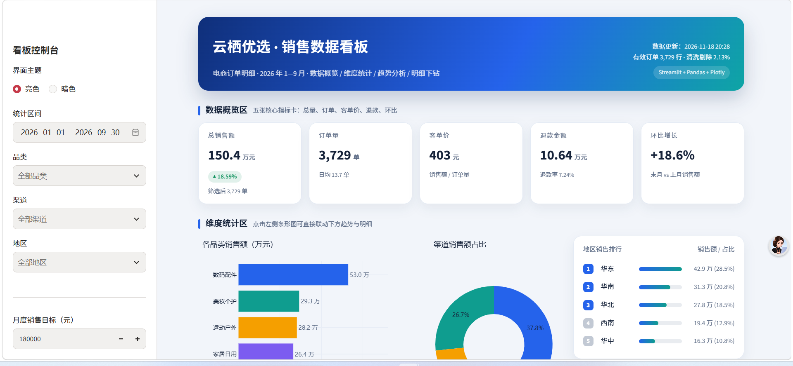

---

## 目录

- [1. 先想清楚：看板和报表不是一回事](#1-先想清楚看板和报表不是一回事)
- [2. 技术选型](#2-技术选型)
- [3. 造一份"带病"的数据](#3-造一份带病的数据)
- [4. 九步清洗：顺序比规则更重要](#4-九步清洗顺序比规则更重要)
- [5. 把口径单独抽成一层](#5-把口径单独抽成一层)
- [6. 版面：四区 + 双主题](#6-版面四区--双主题)
- [7. 图表选型：每种图只回答一个问题](#7-图表选型每种图只回答一个问题)
- [8. 交互：筛选与点击联动](#8-交互筛选与点击联动)
- [9. 实时区：st.fragment 的局部刷新](#9-实时区stfragment-的局部刷新)
- [10. 预警与导出](#10-预警与导出)
- [11. 踩坑清单](#11-踩坑清单)
- [12. 测试：31 条](#12-测试31-条)
- [13. 结果核对与复盘](#13-结果核对与复盘)
- [14. 怎么跑起来](#14-怎么跑起来)

---

## 1. 先想清楚：看板和报表不是一回事

做之前我先问自己一个问题：如果我是运营主管，打开这个页面最先想知道什么？

答案不是"一共有哪些数据"，而是三句话：

1. 这个月卖了多少，离目标还差多少？
2. 哪个品类在涨，哪个在跌？
3. 钱主要从哪个渠道、哪个地区来？

报表负责把数据列全，看板负责把结论摆到最容易被看到的位置。所以这篇实验的顺序是：**先定问题 → 再定区域 → 最后才画图**，而不是先打开 Plotly 文档找好看的图。

三类使用者对应三层信息：

| 使用者 | 关心的问题 | 对应区域 |
| --- | --- | --- |
| 运营主管 | 总量、目标差距、环比 | 数据概览区、趋势分析区 |
| 品类运营 | 结构变化、谁在涨谁在跌 | 维度统计区、多维度分析区 |
| 渠道 / 区域负责人 | 来源结构、地区强弱 | 维度统计区 |

### 实验要求与实现对照

| 要求 | 实现情况 |
| --- | --- |
| 基础 1：需求分析与版面设计（自选场景、四区、配色、草图） | 电商场景；六区布局；亮/暗双色板；版面草图见下 |
| 基础 2：数据准备与预处理（CSV、去空值异常、整理三维度） | 3810 行原始 → 9 步清洗 → 3729 行 |
| 基础 3：≥3 种图表（卡片 / 条形 / 折线 / 环形） | 5 张 KPI 卡、横向条形、双轴图、环形、热力、仪表盘、排行条 |
| 基础 4：单页整合与排版适配 | 单页六区，1920×1080 首屏可读，宽屏自适应 |
| 基础 5：验证与总结（截图、问题与解决） | 31 条测试 + 8 张真实截图 + 问题清单 |
| 进阶 1：动态视觉 | 渐入动画、hover 提示、数值强调 |
| 进阶 2：筛选与图表联动 | 四维筛选 + 点击条形图联动下方图表 |
| 进阶 3：排行榜 / 热力图 / 雷达 / 仪表盘 | 地区排行、品类×月份热力图、目标仪表盘 |
| 扩展 1：实时数据源 | `st.fragment(run_every=5)` 模拟推流 |
| 扩展 2：阈值预警 | 退款率阈值 + 品类环比下滑规则 |
| 扩展 3：大屏与移动端 | 宽屏列布局 + `layout="wide"`，窄屏自动堆叠 |
| 扩展 4：统计分析与报告输出 | 一键导出明细 CSV 与结论 Markdown |
| 扩展 5：个性化 | 排序、点击钻取、亮暗主题 |

---

## 2. 技术选型

| 层 | 选择 | 为什么 |
| --- | --- | --- |
| 页面框架 | Streamlit 1.67 | 写 Python 就是写页面，改一行按 F5 就能看到效果，适合反复调版面 |
| 图表 | Plotly 7.1 | 自带 hover、缩放、点选事件，进阶任务的"联动"直接有官方支持 |
| 数据处理 | Pandas 3.1 | groupby + round 就够用，不需要上数据库 |
| 测试 | pytest 8 | 口径函数是纯函数，测起来很轻 |
| 环境 | Windows 11 + Python 3.13 | 本地跑 `localhost:8511`，截图就是浏览器里的真实页面 |

没有选 Dash，是因为它对"快速改版面"不友好；没有选 Flask + ECharts，是因为要自己写前后端和 JSON 接口，实验的重点是看板设计而不是 Web 工程。

---

## 3. 造一份"带病"的数据

真实业务数据不会刚好干净。为了让清洗环节有东西可讲，我写了一个生成脚本：先造干净数据，再往里注入五类脏数据。

```python
# data/generate_dataset.py（节选）
def build_clean_rows() -> pd.DataFrame:
    random.seed(20260101)          # 固定种子：谁跑都是同一份数据
    ...
    while d <= date(2026, 9, 30):
        for _ in range(_daily_orders(d)):
            rows.append(_make_order(seq, d))
```

订单量不是平均分布的，而是按三条规则叠加：

- 周末上浮 15%（C 端消费的常识）；
- 月内随日期自然增长；
- 3 月 ×1.25、6 月 ×1.65、9 月 ×1.35，对应春季上新、618、开学季。

于是基准数据是 3795 行，字段齐全、金额自洽。接着注入：

| 类型 | 注入方式 | 处数 |
| --- | --- | --- |
| 关键字段缺失 | 8 个关键字段各留空 3 行 | 24 |
| 数值异常 | 数量取 0、-3、999、100；金额取 -199、1000000、0.01；单价取 0 | 24 |
| 日期非法 | `2026-13-45`、`2026/09/31`、`2026-02-30`、`2025-11-20`、`2026-10-08`、空值 | 12 |
| 完全重复 | 整行复制已有记录 | 15 |
| 订单号撞号 | 复用已有订单号 | 8 |

最终 `data/raw_orders.csv` 是 3810 行。

> 这里有个小插曲：第一版我只注入了 30 处，脏数据占比 0.79%，结果清洗时好几条规则一个样本都没抓到，跑完像没跑。把比例调到 2% 之后，九条规则每条都能命中，演示才有说服力。

### 数据流水线

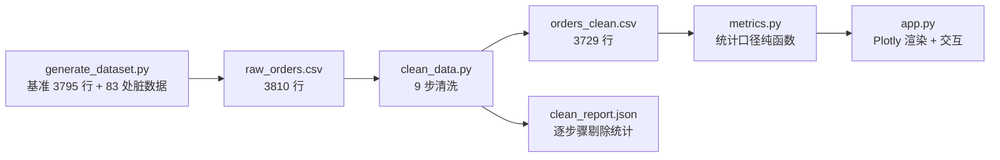

---

## 4. 九步清洗：顺序比规则更重要

清洗规则本身不难，难的是**先做哪一步**。我最终定下的顺序是：

| 步骤 | 规则 | 处理 | 理由 |
| --- | --- | --- | --- |
| 1 | 日期无法解析或不存在（如 2026-02-30） | 剔除 | 无法归入任何月份 |
| 2 | 日期早于 2026-01-01 或晚于 2026-09-30 | 剔除 | 区间外会污染月度口径 |
| 3 | 关键字段为空 | 剔除 | 订单数据插补等于虚构交易 |
| 4 | 数量 ≤ 0 或 > 20 | 剔除 | 上限按单笔业务上限设定 |
| 5 | 单价 ≤ 0 | 剔除 | 无价格无法算金额 |
| 6 | 金额 ≤ 0 | 剔除 | 负金额、零金额都不是有效成交 |
| 7 | 金额与"数量×单价"偏差 > 5% | 剔除，保留行按乘积重算 | 无法判断是金额错还是数量单价错 |
| 8 | 全字段完全一致 | 保留首次出现 | 重复计入会放大总量 |
| 9 | 订单号重复 | 保留首次出现 | 同一订单只应计一次 |

顺序的意义在于：**先修"能不能用"，再修"对不对"，最后修"是不是重复的"**。

- 如果先去重再校验，重复行被提前删掉，金额一致性检查就漏掉了本该发现的异常；
- 如果日期非法的行留到最后，会因为无法按月聚合，直接在绘图阶段报错。

代码用一个 `drop(mask, label, detail)` 闭包把"筛选 + 记账"合并，保证每一次剔除都写进报告：

```python
def drop(mask: pd.Series, label: str, detail: str) -> None:
    nonlocal df
    removed = int(mask.sum())
    df = df[~mask].copy()
    steps.append({"step": label, "detail": detail, "removed": removed, "remain": len(df)})

bad_date = df["order_date"].isna()
drop(bad_date, "日期非法", "无法解析 / 不存在日期（如 2026-02-30、2026/09/31）")
```

金额一致性用**相对偏差**判断，而不是绝对差值，避免小数误差误伤正常行：

```python
expect = (df["quantity"] * df["unit_price"]).round(2)
diff_ratio = (df["amount"] - expect).abs() / expect.replace(0, pd.NA)
inconsistent = diff_ratio.fillna(1.0) > 0.05      # 偏差超 5% 判脏
drop(inconsistent, "金额不一致", "amount 与 数量×单价 偏差 > 5%")
df["amount"] = (df["quantity"] * df["unit_price"]).round(2)   # 保留行统一重算
```

判为不一致的行是**剔除**而不是修正：因为你不知道是金额错了还是数量单价错了，改哪一边都可能把一条真实订单改错。

### 真实终端输出

```text
原始行数：3810
清洗过程：
  - 日期非法     剔除  11 行，剩余 3799 行
  - 日期超区间    剔除   4 行，剩余 3795 行
  - 关键字段缺失   剔除  21 行，剩余 3774 行
  - 数量非法     剔除  12 行，剩余 3762 行
  - 单价非法     剔除   3 行，剩余 3759 行
  - 金额非法     剔除   4 行，剩余 3755 行
  - 金额不一致    剔除   5 行，剩余 3750 行
  - 完全重复行    剔除  14 行，剩余 3736 行
  - 订单号重复    剔除   7 行，剩余 3729 行
清洗后行数：3729，脏数据占比 2.13%
销售额合计：1,503,956.26 元
订单数：3729，客单价：403.31 元
退款率：7.24%
日期区间：2026-01-01 ~ 2026-09-30
```

每一步的剔除数都落在 `data/clean_report.json` 里，看板底部的"清洗日志"折叠面板直接读这份报告——页面上写的"剔除 2.13%"和日志里的数字出自同一处，不会出现两套口径。

---

## 5. 把口径单独抽成一层

这是这次实验里我认为最值的一个决定：**页面里不写计算**。

`src/metrics.py` 里全部是纯函数，输入 DataFrame，输出数字或小表：

```python
def kpi_summary(df: pd.DataFrame) -> dict:
    orders = int(len(df))
    total = round(float(df["amount"].sum()), 2) if orders else 0.0
    refund_amount = round(float(df["refund_amount"].sum()), 2) if orders else 0.0
    return {
        "total_amount": total,
        "orders": orders,
        "avg_order_value": round(total / orders, 2) if orders else 0.0,
        "refund_amount": refund_amount,
        "refund_rate": round(float(df["refund_flag"].mean()), 4) if orders else 0.0,
    }
```

好处有三个：

1. 改配色、改布局不会影响数字；
2. 每个口径都能在测试里单独验证，不用起服务点页面；
3. 页面只负责"把数字变成视觉"，职责单一。

口径清单：`load_orders`、`filter_orders`、`kpi_summary`、`monthly_trend`、`mom_growth`、`category_summary`、`channel_share`、`region_rank`、`member_summary`、`category_month_matrix`、`target_achievement`、`category_mom_drop`、`build_text_report`。

---

## 6. 版面：四区 + 双主题

### 结构

主区是"左筛选、右内容"的两栏：侧边栏放七项控制（主题、区间、品类、渠道、地区、销售目标、预警阈值），主区按五列网格排布。

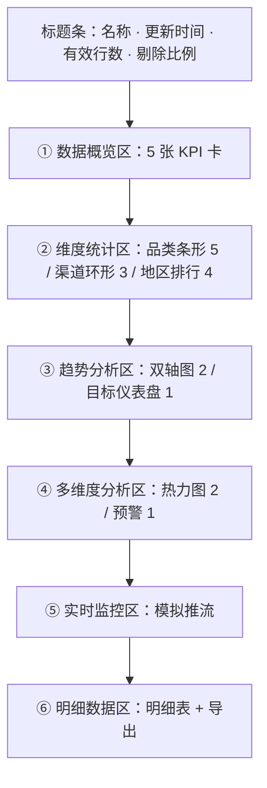

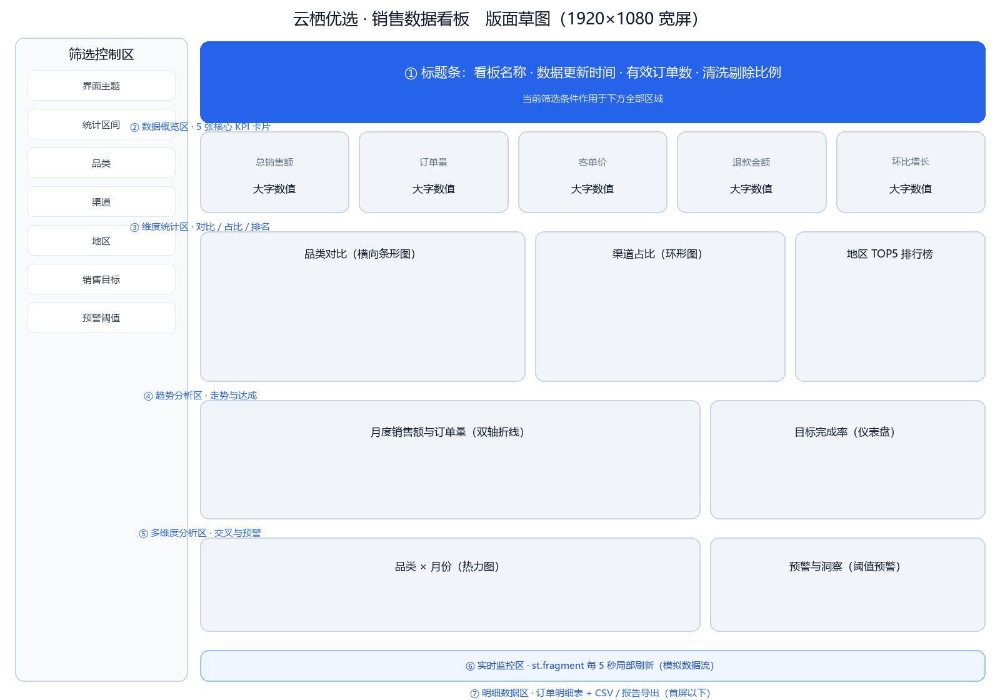

首屏（1920×1080）能同时放下标题、五张指标卡和维度区上半部分——不滚动就能拿到当天最关键的结论。这是有意的：如果用户第一屏就要滚动，那他大概率不会再往下看。

### 双主题：CSS 变量 + 占位符替换

两种主题不是两套代码，而是一套模板 + 两套色板。模板里用 `__BG__`、`__CARD__` 这类占位符，运行时替换：

```python
PALETTES = {
    "亮色": {"bg": "#f2f5fa", "card": "#ffffff", "text": "#16233a",
             "primary": "#2563eb", "series": ["#2563eb", "#0f9d8f", "#f59f00",
                                               "#7c5cf0", "#e8590c", "#2f9e44"], ...},
    "暗色": {"bg": "#0b1220", "card": "#131c2e", "text": "#e8edf7",
             "primary": "#4c8dff", ...},
}

st.markdown(
    CSS_TEMPLATE.replace("__BG__", pal["bg"]).replace("__CARD__", pal["card"])
    .replace("__TEXT__", pal["text"])..., unsafe_allow_html=True)
```

配色规则只有两条：

- **同义同色**：六个品类的颜色按销售额降序固定映射，筛选条件变了颜色也不重排，这样同一个品类在条形图、环形图、热力图里始终是同一个色；
- **语义色独立**：上涨 #0B8F5A、预警 #C92A2A，不跟系列色混用。

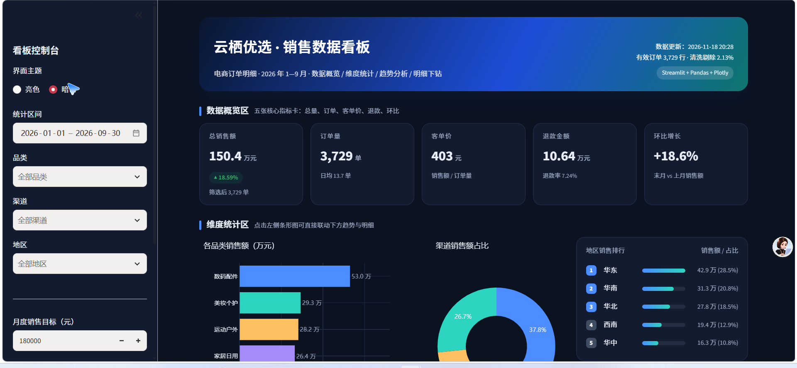

---

## 7. 图表选型：每种图只回答一个问题

| 图表 | 回答什么 | 为什么不用别的 |
| --- | --- | --- |
| KPI 卡 ×5 | 现在怎么样 | 数字比图形快，还能把口径写在同一张卡里 |
| 横向条形 | 品类之间谁高谁低 | 中文品类名较长，横排不会挤；条尾直接标数值 |
| 环形图 | 渠道占比 | 中心留白放总额，比饼图更容易读 |
| 双轴图（柱 + 折线） | 量价怎么变 | 订单量与销售额量级差 10 倍，双轴才能同屏 |
| 热力图 | 品类×月份交叉 | 两个分类维度 + 一个数值，热力图最省地方 |
| 仪表盘 | 目标完成率 | 单一比率，"差多少"比"趋势"更重要 |
| 排行条 | 地区强弱 | 排行语义，序号 + 占比条比柱状图直白 |

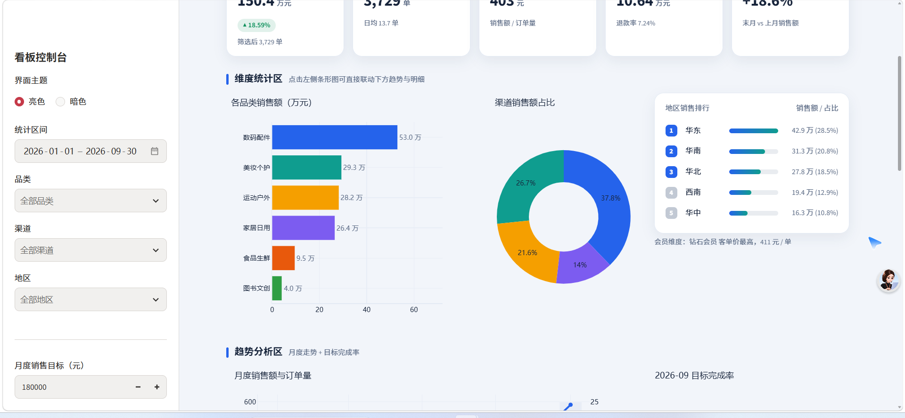

条形图的一段代码（注意 `textposition="outside"` 与边距，中文标签才不会被裁）：

```python
fig_bar = go.Figure(go.Bar(
    x=cats_df["amount"] / 10000, y=cats_df["category"], orientation="h",
    text=[f"{v / 10000:.1f} 万" for v in cats_df["amount"]],
    textposition="outside",
))
fig_bar.update_xaxes(title=None, range=[0, max(cats_df["amount"] / 10000) * 1.36])
fig_bar.update_layout(margin=dict(l=78, r=52, t=50, b=28))
```

双轴图里，订单量用浅色柱、销售额用折线并挂到右轴，两条序列共用一个时间轴，于是"单量涨了但客单价降了"这种结构变化能一眼看出来：

```python
fig_line.add_trace(go.Bar(x=trend["month"], y=trend["orders"], name="订单量"))
fig_line.add_trace(go.Scatter(x=trend["month"], y=trend["amount"] / 10000, name="销售额",
                              mode="lines+markers", yaxis="y2"))
fig_line.update_layout(
    yaxis=dict(title="订单量（单）"),
    yaxis2=dict(title="销售额（万元）", overlaying="y", side="right"),
    hovermode="x unified",
)
fig_line.update_xaxes(type="category")     # 否则 2026-01 会被解析成 Jan 2026
```

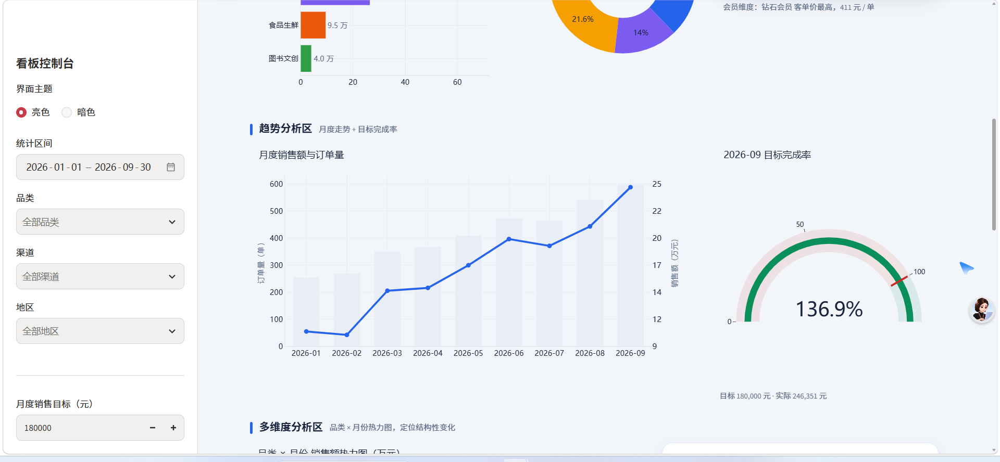

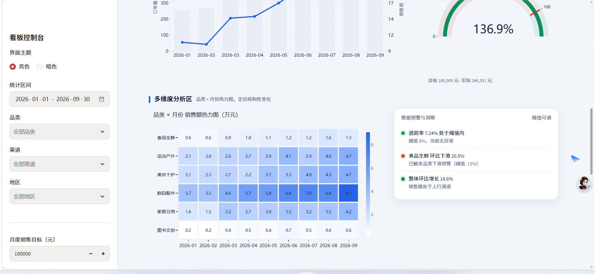

---

## 8. 交互：筛选与点击联动

### 筛选

四组条件在 `filter_orders` 里一次性作用到主数据，下游所有图表共用同一个结果——这样不会出现"这张图过滤了、那张图没过滤"的错位。

```python
def filter_orders(df, start=None, end=None, categories=None, channels=None, regions=None):
    mask = pd.Series(True, index=df.index)
    if start is not None:
        mask &= df["order_date"] >= pd.Timestamp(start)
    if end is not None:
        mask &= df["order_date"] <= pd.Timestamp(end)
    if categories:
        mask &= df["category"].isin(categories)
    ...
    return df.loc[mask].copy()
```

### 点击联动

这是进阶任务里最花时间的一块。目标：点品类条形图的任意一条，下面的趋势图、热力图、明细表都切到该品类，并且**能一键退回**。

```python
ev = st.plotly_chart(fig_bar, width="stretch", theme=None, key="chart_category",
                     on_select="rerun", selection_mode="points",
                     config={"displayModeBar": False})
clicked = None
try:
    pts = ev["selection"]["points"]
    if pts:
        clicked = pts[0].get("y") or pts[0].get("label")
except Exception:                 # 未发生选择时返回结构不同
    clicked = None
if clicked and clicked != st.session_state.get("drill_cat"):
    st.session_state["drill_cat"] = clicked
    st.rerun()
```

三个参数是关键：`on_select="rerun"` 让选择触发重跑，`selection_mode="points"` 只接收点，`key` 固定图表身份以便复用状态。

两个细节值得写下来：

- **取点要容错**：没有选择时返回的结构和选中时不一样，直接 `ev["selection"]["points"][0]` 会抛异常；
- **联动要显式**：取到的值写进 `session_state` 再 `st.rerun()`，让"当前在看哪个品类"成为一个可清除的状态，而不是一次性的点击事件。

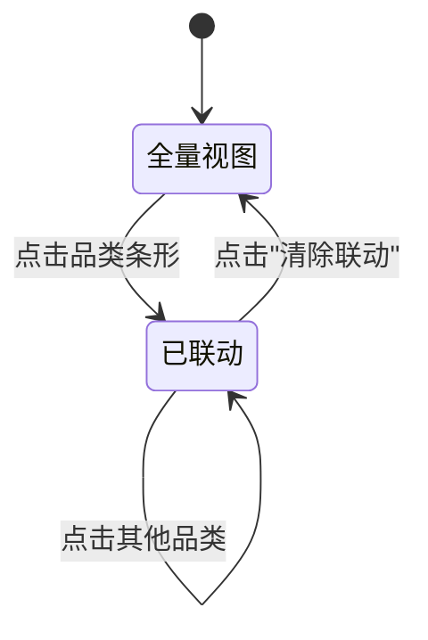

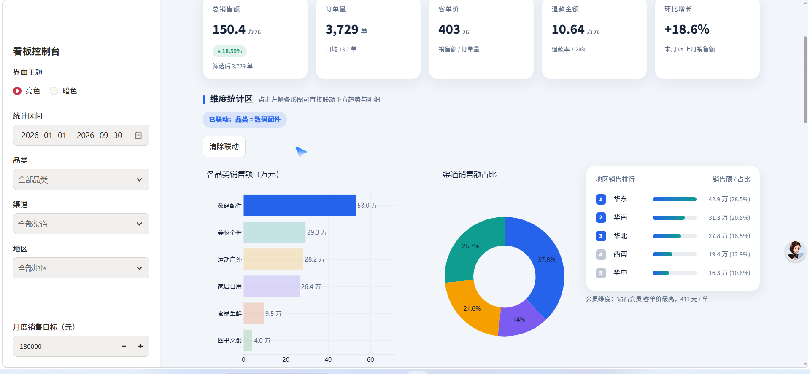

---

## 9. 实时区：st.fragment 的局部刷新

静态看板每次刷新都重算全量，实时看板只更新增量。Streamlit 1.67 的 `st.fragment` 正好能做这件事：只重绘被装饰的函数，页面其他部分和滚动位置都不动。

```python
@st.fragment(run_every=5)
def live_panel(enabled: bool) -> None:
    if not enabled:
        st.caption("在侧边栏打开「模拟实时数据流」后，本区域每 5 秒自动刷新，其余区域保持不动。")
        return
    state = st.session_state.setdefault("live_orders", [])
    state.extend([make_live_order(random.Random()) for _ in range(2)])
    del state[:-24]                       # 只保留最近 24 笔
    live = pd.DataFrame(state)
    ...
```

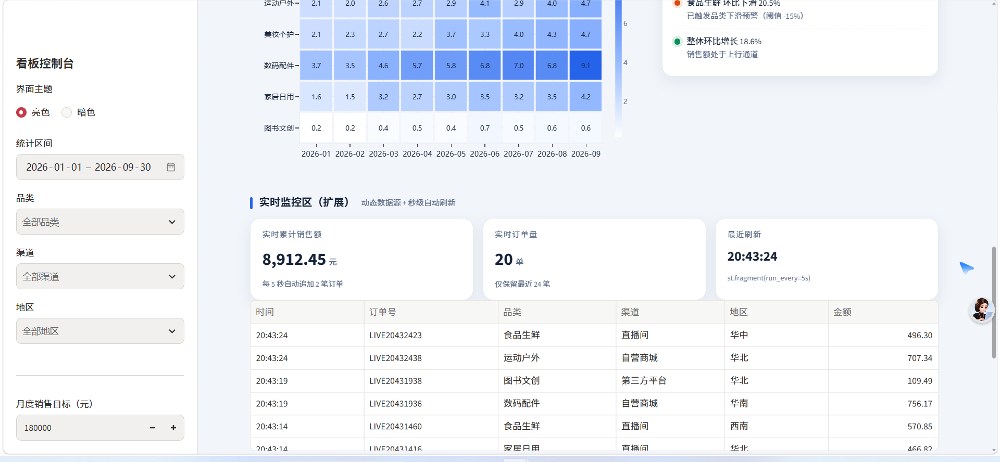

| | 静态看板 | 实时看板 |
| --- | --- | --- |
| 刷新粒度 | 整页重算 | 局部增量 |
| 数据来源 | 落盘文件 | 推流 / 消息队列 |
| 一致性 | 强，全量同源 | 需处理乱序与重复 |
| 适用 | 日报、周报 | 大促值守、监控 |

> 需要说明的是，这里的实时是**模拟**的：订单在内存里生成，刷新页面就从零累计。真要上线，得把数据源换成消息队列或数据库增量。

---

## 10. 预警与导出

预警只有两条规则，但直接给结论：

- 退款率超过侧边栏设定的阈值（默认 8%，当前 7.24%）→ 红色；
- 品类环比下滑超过 15% → 黄色，食品生鲜 9 月 -20.5% 被单独点名。

预警的价值在于"不用逐图比对也能发现问题"。图表把异常藏在颜色里，文字则把它说出来。

导出有两档：明细 CSV（当前筛选后的订单行）和报告 Markdown（指标、品类结构、渠道占比、预警结论），后者可以直接贴进周报。

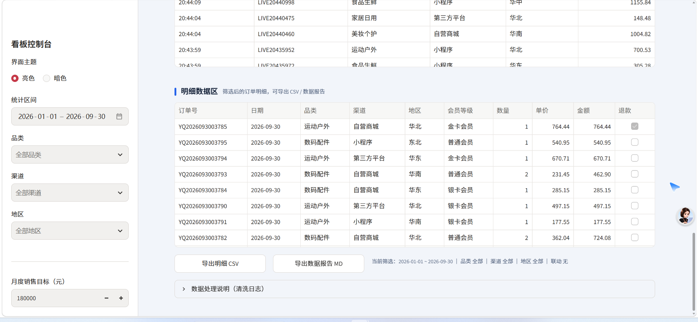

---

## 11. 踩坑清单

| 问题 | 现象 | 原因 | 解决 |
| --- | --- | --- | --- |
| 坐标轴标签被裁 | 中文品类名、条尾数值显示不全 | 默认边距按英文短标签设计 | `margin=dict(l=78, r=52)`，横轴上限放宽到 1.36 倍 |
| 月份变英文 | `2026-01` 显示成 `Jan 2026` | Plotly 把字符串自动推断成日期 | `update_xaxes(type="category")` |
| 暗色主题字看不清 | 侧边栏标题在深底上发灰 | 自定义样式没覆盖控件标签 | 对 `label`、`p`、`h3` 补颜色，刻意不覆盖下拉框内部 |
| 实时刷新打断操作 | 每 5 秒整页重绘，滚动位置跳回 | 刷新粒度是整页 | 改用 `st.fragment` |
| 数字漂移 | 两次生成数据总额不同 | 未固定随机种子 | `random.seed(20260101)` |
| 宽度参数更名 | 照旧教程写 `use_container_width` 会报参数不支持 | 1.67 起统一改成 `width` | 全部改用 `width="stretch"` |

其中暗色主题那条最典型：自定义 CSS 改了背景色和正文色，但 Streamlit 控件的标签用的是自己的一套变量，结果深底配深灰字，几乎看不清。最后的做法是只补标签颜色，**不覆盖下拉框内部样式**——原生下拉框是浅底，白字反而更糟。

---

## 12. 测试：31 条

口径和清洗都写成纯函数之后，测试就变得很便宜。

```text
============================= 31 passed in 2.98s ==============================
```

| 测试文件 | 用例数 | 覆盖内容 |
| --- | --- | --- |
| `tests/test_clean_data.py` | 19 | 8 个关键字段缺失、非法日期、超区间、异常数量、零单价、负金额、金额不一致与重算、完全重复、订单号重复、报告口径一致性 |
| `tests/test_metrics.py` | 12 | 筛选、KPI、月度趋势、环比、占比合计为 1、地区前五、目标完成率、报告文本 |

举例，清洗规则用参数化把"该剔除的"逐个钉死，再用一条用例守住"金额必须重算到两位小数"：

```python
@pytest.mark.parametrize("qty", [0, -3, MAX_QUANTITY + 1])
def test_bad_quantity_dropped(qty):
    df, _ = clean_one(quantity=qty, amount=qty * 100.0)
    assert len(df) == 0

def test_amount_recalculated_to_two_decimals():
    df, _ = clean_one(quantity=3, unit_price=33.333, amount=99.999)
    assert len(df) == 1
    assert float(df.iloc[0]["amount"]) == round(3 * 33.333, 2)
```

---

## 13. 结果核对与复盘

界面上的数字不能"看起来对"，所以我另写了一段**不经过看板**的脚本，直接读 `orders_clean.csv` 重算一遍：

| 指标 | 界面显示 | 独立计算 | 是否一致 |
| --- | --- | --- | --- |
| 总销售额 | 150.4 万元 | 1,503,956.26 元 | 一致 |
| 订单量 | 3,729 单 | 3,729 单 | 一致 |
| 客单价 | 403 元 | 403.31 元 | 一致 |
| 退款金额 | 10.64 万元 | 106,364.66 元 | 一致 |
| 环比增长 | +18.6% | +18.59% | 一致 |
| 目标完成率 | 136.9% | 136.86% | 一致 |

界面上的"150.4 万元""403 元"是显示时的四舍五入，原始值分别是 1,503,956.26 元、403.31 元。

### 三条经验

**第一，看板的难点不在画图，而在排序。** 同样的数据，把总销售额放第一屏、把热力图放第三屏，是和使用者的问题顺序对应的；反过来排，看板就变成图表展览。

**第二，口径必须前置。** 最初想把环比直接写在页面里算，后来全部收进 `metrics.py` 并用测试固定。改配色、改布局都不会影响数字，也不会出现"两处各算一次、结果差 0.1%"。

**第三，交互要能回来。** 联动很容易做成"点了就跳走"，用户找不到原来的视图。加上联动标记和清除按钮之后，任何一次下钻都能一步退回全量，交互才算可用。

### 还不够的地方

- 实时区是内存模拟，刷新页面从零累计，下一步想接 SQLite 或消息源；
- 配色与主题只覆盖自定义组件，原生控件仍是浏览器默认样式；
- 品类下钻是整页切数据，做成侧滑面板会更接近真实业务看板。

---

## 14. 怎么跑起来

```bash
git clone https://github.com/Hanna2126/streamlit-sales-dashboard-lab2.git
cd streamlit-sales-dashboard-lab2
pip install -r requirements.txt

python data/generate_dataset.py      # 生成含脏数据的原始数据
python data/clean_data.py            # 清洗，输出 orders_clean.csv 与报告
python -m streamlit run app.py       # 打开 http://localhost:8501

python -m pytest tests -v            # 31 条测试
```

目录：

```text
dashboard-lab2/
├─ app.py                 # 看板主程序
├─ src/metrics.py         # 统计口径
├─ data/                  # 生成、清洗、数据文件
├─ tests/                 # 31 条测试
├─ 截图/                   # 8 张真实运行截图
├─ blog/                  # 本文与配图
├─ 实验报告.docx
└─ README.md / 验证记录.md
```

---

## 写在最后

这次实验最深的体会是：**数据思维不是"会算"，而是"知道为什么这么算"**。

同样的 `sum(amount)`，在清洗前算出来是错的，在清洗后算出来才是销售额；同样的"环比"，定义成"最后一个月 vs 上一个月"，还是"整段区间 vs 上一段区间"，结论可能完全相反。看板把这些问题放大到一屏之内，逼着你先把口径想清楚，再去挑颜色。

至于开发方式：这次的分工是「我定问题和验收标准，AI 出实现，我逐条验证」。凡是没在浏览器里跑出来的数字、没在终端里打出来的 `passed`，都不算完成——截图和日志就是证据。

---

*实验环境：Windows 11 · Python 3.13.18 · Streamlit 1.67.0 · Plotly 7.1.0 · Pandas 3.1.1*
